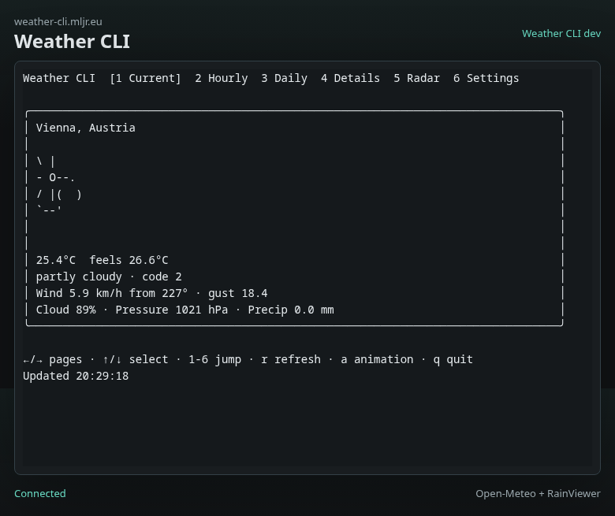

# Weather CLI

A Go terminal weather app with a Bubble Tea interface, animated weather icons, Open-Meteo forecast data, and RainViewer radar timelines.

The hosted version runs the same CLI inside a browser terminal at [weather-cli.mljr.eu](https://weather-cli.mljr.eu). The web shell uses xterm.js, the xterm image addon when available, a small Go WASM helper, and a server-side PTY bridge so the terminal UI behaves like the native app.



## Features

- Current, hourly, daily, details, radar, settings, and icon gallery pages.
- Open-Meteo geocoding and forecasts with no API key required.
- RainViewer radar timelines with a built-in ANSI half-block renderer.
- Native terminal mode for local use.
- Browser terminal mode using xterm.js over WebSockets.
- Docker image published to GitHub Container Registry.

## Run Locally

```sh
make run
```

Useful flags:

```sh
go run -buildvcs=false ./cmd/weather-cli --location "Vienna"
go run -buildvcs=false ./cmd/weather-cli --lat 48.2082 --lon 16.3738
go run -buildvcs=false ./cmd/weather-cli --units imperial
go run -buildvcs=false ./cmd/weather-cli --map-provider rainviewer
go run -buildvcs=false ./cmd/weather-cli --map-provider openmeteo
go run -buildvcs=false ./cmd/weather-cli --radar-autoplay
go run -buildvcs=false ./cmd/weather-cli --render-mode blocks
go run -buildvcs=false ./cmd/weather-cli --render-mode viu
go run -buildvcs=false ./cmd/weather-cli --render-mode termimg
go run -buildvcs=false ./cmd/weather-cli --icon-style unicode
go run -buildvcs=false ./cmd/weather-cli --no-animation
go run -buildvcs=false ./cmd/weather-cli --page icons
```

The app also loads `.env` from the current working directory before reading environment variables. Make targets include `.env` as well.

## Browser Terminal

Build and run the browser bridge:

```sh
make build-web
make web
```

Open [http://127.0.0.1:8080](http://127.0.0.1:8080). The web server starts a fresh `weather-cli` process per WebSocket session and connects it to xterm.js through a PTY.

Relevant environment variables:

```sh
WEATHER_CLI_WEB_ADDR=:8080
WEATHER_CLI_BIN=/usr/local/bin/weather-cli
WEATHER_CLI_STATIC_ROOT=/app/web/static
WEATHER_CLI_WEB_CONFIG_DIR=/tmp/weather-cli
WEATHER_CLI_LOCATION=Vienna
WEATHER_CLI_UNITS=metric
WEATHER_CLI_RENDER_MODE=blocks
```

## Docker

```sh
make docker-build
make docker-run
```

Published image:

```text
ghcr.io/mrcodeeu/weather-cli:latest
```

The container listens on port `8080` internally and includes a `/health` endpoint for deployment checks.

## Deployment

This repo includes a GitHub Actions workflow that:

1. runs the Go tests,
2. builds the WASM helper,
3. builds and pushes `ghcr.io/mrcodeeu/weather-cli`,
4. dispatches `MrCodeEU/homelab-automation` with `service-update`.

The homelab service is configured for:

```text
https://weather-cli.mljr.eu -> mljr:8091 -> container:8080
```

## Controls

Every page shows the navigation footer:

```text
←/→ pages · ↑/↓ select · 1-6 jump · r refresh · a animation · q quit
```

The radar page also supports `+/-` zoom, `m` to cycle render mode, and `p` to toggle one-second radar frame autoplay. The icon gallery is intentionally outside normal navigation, shows ASCII and Unicode icon sets side-by-side, and opens with `make icon-test`.

## Quality

```sh
make fmt
make test
make lint
make check
```

## Data Sources

- Open-Meteo: location search, current conditions, hourly forecast, daily forecast, weather codes, and synthetic precipitation forecast maps.
- RainViewer: no-key radar timeline, visible attribution, and map rendering over OpenStreetMap base tiles.

The radar page fetches the selected PNG tile, overlays it on a land/water basemap, marks the selected location, and scales the render to the current terminal size. In `auto` mode it tries `viu` first, falls back to `go-termimg`, and then falls back to the stable built-in ANSI half-block renderer. The source URL and effective renderer remain visible below the rendered tile for debugging.

## Settings

The settings page is editable:

- `↑/↓` selects a setting.
- `enter` edits text values, cycles enum values, or toggles animation.
- Changes save to the user config file automatically; `s` can still force a save.

Environment variables and `.env` values still override saved config on startup. Supported environment overrides include `WEATHER_CLI_ICON_STYLE=ascii|unicode` and `WEATHER_CLI_RADAR_AUTOPLAY=true|false`.
